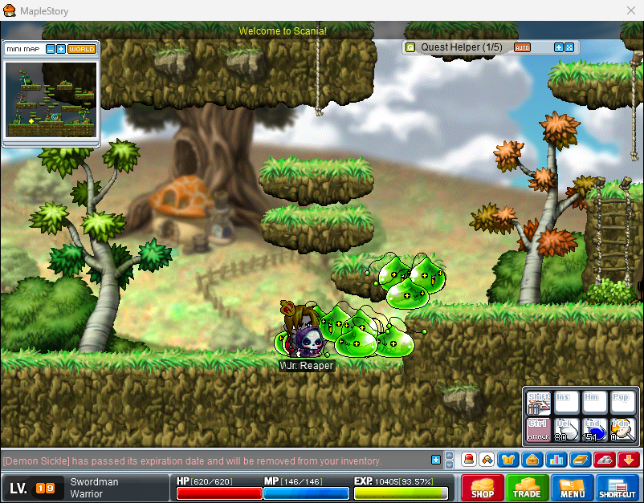
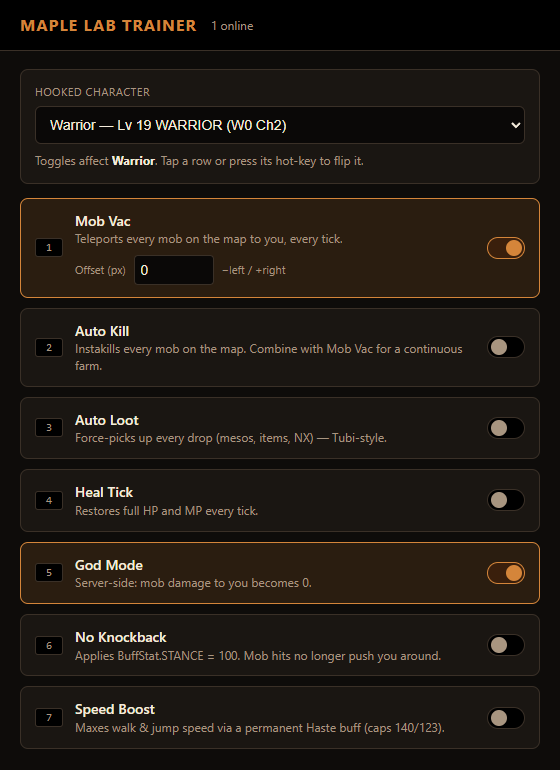
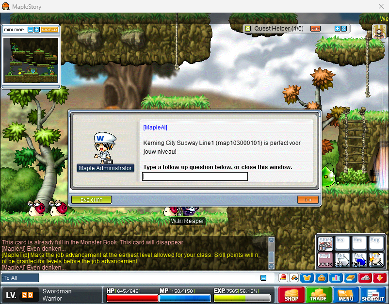
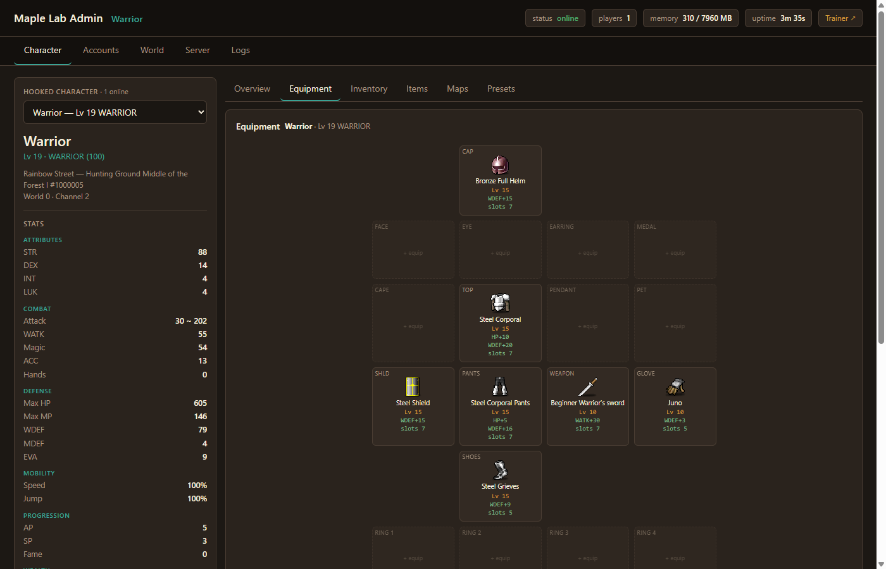
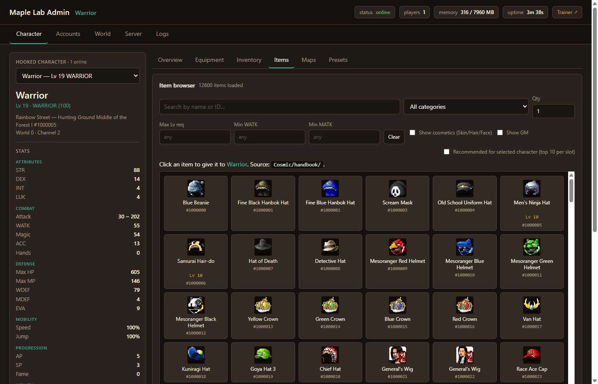
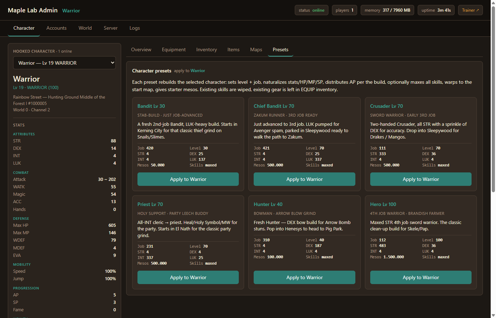
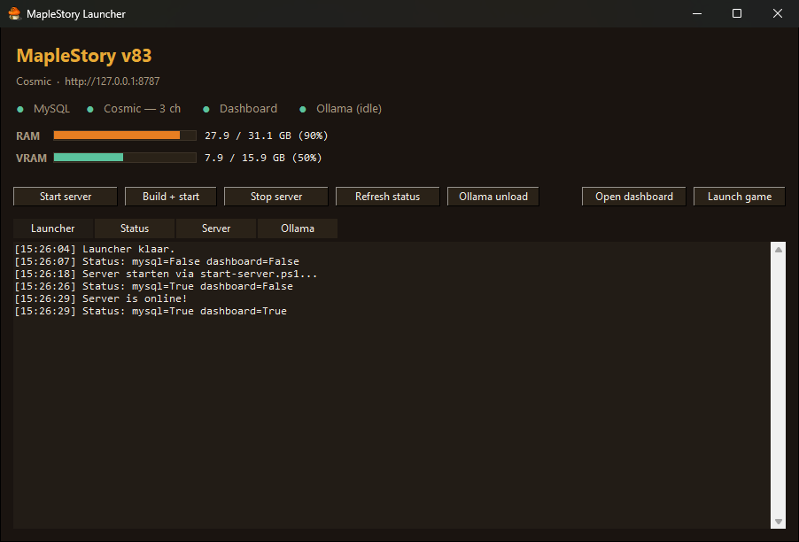
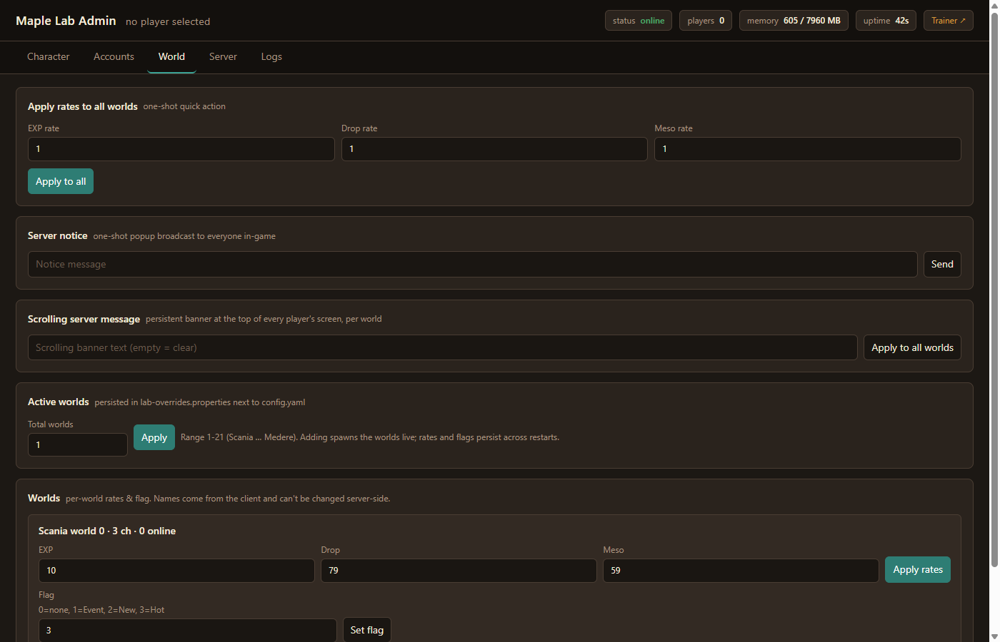

# MapleStory Lab

**Je eigen MapleStory v83-server op je pc, om mee te spelen en te experimenteren.** Gebouwd op de open-source
emulator [Cosmic](https://github.com/P0nk/Cosmic), met daarbovenop een launcher, een admin-dashboard in je browser,
een trainer met klassieke "hacks" die volledig server-side werken, en **MapleAI**: een AI-assistent in de game die
via een lokaal taalmodel (Ollama) je vragen beantwoordt en zelf dingen voor je kan doen.

<table>
  <tr>
    <td width="50%"></td>
    <td width="50%"></td>
  </tr>
  <tr>
    <td><b>In de game:</b> Mob Vac trekt alle monsters van de map naar je toe...</td>
    <td>...met één schakelaar (of sneltoets) in de <b>trainer</b>, naast God Mode, Auto Kill, Auto Loot en meer.</td>
  </tr>
</table>

## Wat zit erin

- **Launcher.** Eén venster om MySQL, de server en het dashboard te starten en te stoppen, met de status van alles,
  het geheugengebruik (RAM en VRAM, voor het AI-model) en een knop om de game te starten.
- **Admin-dashboard** op [127.0.0.1:8787](http://127.0.0.1:8787). Kies een online character en pas zijn stats,
  level en job aan, bekijk zijn equipment en inventory, geef items uit een catalogus van ruim 12.000, warp hem naar
  een van 4.400 maps, of zet hem in één klik neer als een complete build (*Chief Bandit Lv 70*, *Hero Lv 100*, ...).
  Verder: accounts, rates per world, servermeldingen, logs en een console voor alle GM-commands.
- **Trainer** ([127.0.0.1:8787/trainer](http://127.0.0.1:8787/trainer)): Mob Vac, Auto Kill, Auto Loot, Heal Tick,
  God Mode, No Knockback en Speed Boost voor het gekoppelde character, met sneltoetsen 1–7. Alles gebeurt op de
  server; er komt geen Cheat Engine, injector of clientpatch aan te pas.
- **MapleAI.** Typ `@ai` en je vraag in de chat, of fluister naar *MapleAI*. Het model (standaard `gpt-oss:20b` via
  [Ollama](https://ollama.com)) kan tools gebruiken: de beste trainingsmap voor je level zoeken, items en maps
  opzoeken, equipment aanraden, je warpen of een item geven.
- **GM-commands** voor in de game, zoals `!godmode`, `!mobvac`, `!tubi`, `!killall` en `!exprate 20`; zie
  [Lokale cheat-lab commands](#lokale-cheat-lab-commands).
- **Installers** (Inno Setup): een complete installatie met draagbare Java en MySQL, de server, de launcher en de
  client die je zelf aanlevert, en een losse client-installer voor medespelers.

<table>
  <tr>
    <td width="50%"></td>
    <td width="50%"></td>
  </tr>
  <tr>
    <td><b>MapleAI:</b> "welke map is goed om te trainen voor mij?" Het model zocht het zelf op met een tool.</td>
    <td><b>Dashboard:</b> je character, zijn stats en zijn equipment.</td>
  </tr>
  <tr>
    <td></td>
    <td></td>
  </tr>
  <tr>
    <td><b>Items:</b> zoeken, filteren en met een klik geven.</td>
    <td><b>Presets:</b> in één keer een complete build voor je character.</td>
  </tr>
  <tr>
    <td></td>
    <td></td>
  </tr>
  <tr>
    <td><b>Launcher:</b> alles starten en in de gaten houden.</td>
    <td><b>World:</b> rates, meldingen en worlds, live.</td>
  </tr>
</table>

## Snel starten

Na de [installatie](docs/installatie.md) (Java 21, MySQL 8, de server bouwen):

| Bestand | Wat het doet |
|---|---|
| `Start MapleStory.bat` | De launcher: start en stopt alles en start de game |
| `START.cmd` | De server starten zonder launcher |
| `BUILD-START.cmd` | Na een codewijziging: bouwen en starten (stop de server eerst) |
| `STOP.cmd` | De server stoppen |

Log in de game in met een nieuwe naam en wachtwoord: het account wordt automatisch aangemaakt. Voor de GM-commands heeft je
character GM-rechten nodig; zie [Account en GM/Admin](docs/installatie.md#account-en-gmadmin).
Voor MapleAI moet Ollama draaien met het model erin (`ollama pull gpt-oss:20b`).

## Wat je nodig hebt

- Windows 11, Java 21 (bijvoorbeeld Amazon Corretto) en MySQL 8.4; Maven zit in de repo (`mvnw.cmd`).
- **De game zelf lever je zelf aan.** Deze repo bevat geen MapleStory-client, geen WZ-bestanden en geen andere
  bestanden van Nexon/Wizet: een compatibele GMS v83-client en de bijpassende WZ-data moet je zelf legaal hebben.
- Voor MapleAI: [Ollama](https://ollama.com) met een model dat tools ondersteunt (standaard `gpt-oss:20b`, ~13 GB).

## Lokaal of online

Standaard draait alles alleen op deze pc: `Cosmic/config.yaml` gebruikt `127.0.0.1`, het dashboard en MySQL luisteren
alleen op `127.0.0.1`, en er gaan geen firewallpoorten open. Wil je met anderen spelen, zet dan je eigen adressen in
`Cosmic/config.local.properties` (staat niet in Git):

```properties
HOST=jouw.domein.of.publiek.ip
LANHOST=192.168.x.y
```

Spelers van buitenaf hebben daarnaast doorgestuurde poorten nodig (login `8484`, kanalen `7575`–`7577`) en een
client die naar jouw adres wijst; de client-installer (`installer/MapleStoryLabClient.iss`) installeert die. Denk
daarbij aan wat je openzet: het dashboard en MySQL horen nooit buiten `127.0.0.1`.

## Lokale cheat-lab commands

Server-side commands voor GM level 4+, zonder Cheat Engine, injector of clientpatch:

```text
!godmode   !mobvac   !tubi   !lootvac   !forcevac   !killall
!droprate 20   !exprate 20   !mesorate 20
```

- `!godmode`: schade van mobs wordt 0, tot je het opnieuw togglet of opnieuw inlogt.
- `!mobvac` / `!vac`: alle mobs van de map naar jouw positie.
- `!tubi` / `!forcevac`: alle drops op de map oppakken, ook die normaal niet van jou zijn.
- `!lootvac` / `!vacloot` / `!itemvac`: drops oppakken via de normale pickup-route.
- `!killall`: alle mobs op de map doden.
- `!droprate`, `!exprate`, `!mesorate`: wereldrates aanpassen terwijl de server draait.

Bestaat een command niet, dan draait waarschijnlijk nog een oude serverjar: `STOP.cmd` en dan `BUILD-START.cmd`.

## Veiligheid en spelregels

- Download geen clients, localhost-exe's, injectors of tools van obscure forums. Geeft een clientbestand een
  antiviruswaarschuwing of komt het van een mirror, behandel het dan als onbetrouwbaar tenzij je de herkomst en hash
  zelf kunt verantwoorden.
- Gebruik niets hiervan tegen de officiële servers van Nexon; dit lab is voor je eigen server.
- Bouw "hacks" server-side na (zoals de trainer en de GM-commands) in plaats van de client te hacken.

## Documentatie

| Document | Inhoud |
|---|---|
| [Installatie en achtergrond](docs/installatie.md) | Handmatige installatie, de keuze voor Cosmic, logininstellingen, GM-rechten, ideeën voor experimenten |
| [Troubleshooting](troubleshooting.md) | Foutoplossing |
| [Cosmic](Cosmic/README.md) | De upstream server: features, WZ-data, configuratie |

## Licentie

De server is [Cosmic](https://github.com/P0nk/Cosmic), een afgeleide van HeavenMS en OdinMS, onder de
[GNU AGPL-3.0](Cosmic/LICENSE); dat geldt ook voor de aanpassingen in `Cosmic/`. MapleStory en alle bijbehorende artwork, namen en data zijn van Nexon; die zitten niet in deze repo.
De screenshots hierboven zijn gemaakt met een eigen, zelf aangeleverde client.
